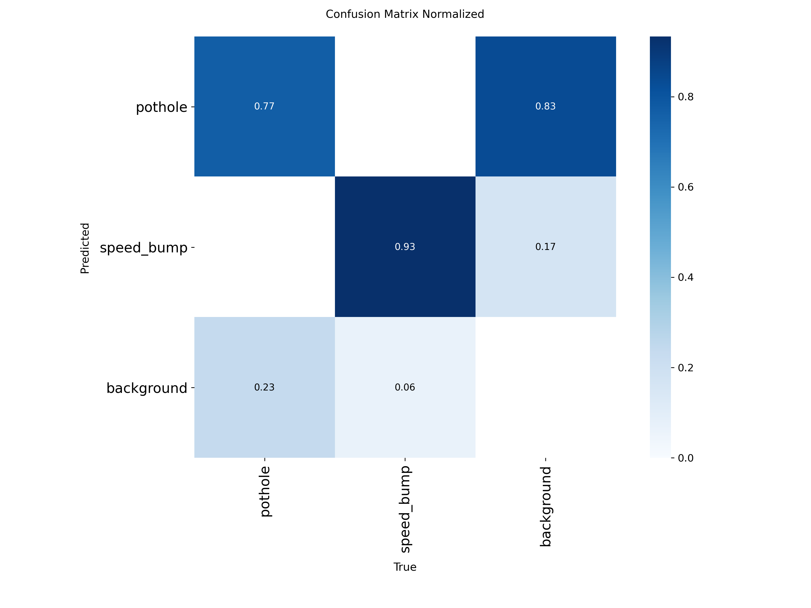

# ICVSP: Trust-Aware Cooperative Vehicle Safety Platform (prototype)

Graduation project, 2026–2027. A low-cost, retrofit in-vehicle unit that detects road hazards
(potholes, speed bumps), verifies them with on-board sensors and reports from other vehicles, and
warns approaching drivers. It keeps working when the cloud or network is unavailable.

This repository holds the working prototypes:
- **`3_WEB_SW/code/engine/`: the trust & consensus engine**, the decision layer and the core of the project. It decides, with a
  written reason, whether reported hazards are real enough to warn anyone, and who.
- **`4_AI_SW/code/`: the camera-based hazard detectors** that produce the reports: YOLO11n for the Pro unit and ESPDet-Pico
  for a low-cost ESP32-S3 unit.
- **`1_XAIO_SW/`: the device firmware** (ESP-IDF, XIAO ESP32-S3 Sense): camera, IMU, GNSS, BLE to the phone, signed
  reports and replay protection, tested on the physical board.
- **`3_WEB_SW/code/backend_sw/`: the server** (FastAPI): checks signed reports, runs the trust engine, answers "which hazards are ahead?"
  and has an operator dashboard.
- **`2_FLUTTER_SW/code/`: the ROVO phone app** (Flutter): BLE link to the device, local warnings, map.
- **`5_TESTING/`: board test cases and their logs, laptop tests, and V-cycle evidence**: requirement → test → result traceability, checked on every push.

## Current status

| Component | Status |
|---|---|
| Trust & consensus engine (schema checks, plausibility, trust, consensus, Sybil / replay defence, targeting) | ✅ Prototype, 52 tests, evaluated in simulation; accepts pothole and speed-bump reports; warns only about hazards big enough to make a driver stop, slow down or swerve (proposed FR-27) |
| Camera detector, Pro unit (YOLO11n) | ✅ v3c, fine-tuned on Egyptian day and night footage: public test mAP50 0.846 |
| False-alarm filters for speed bumps (road-surface check, motion check) | ✅ Cut false bump flags by over 95 % on held-out Egyptian video |
| Egyptian road tests | 🟡 Potholes detected above chance by day and night; many unpainted bumps are barely visible on camera, so the IMU becomes the main bump sensor. Own recordings needed for a larger test set |
| Device logic (IMU detector, camera decision logic, camera + IMU fusion, signed reports, replay window, report queue, delivery, NMEA parser) | ✅ 110 unit tests on a laptop against the firmware's own components; thresholds still to be tuned on real drives |
| ECU firmware on the board (XIAO ESP32-S3 Sense, ESP-IDF) | 🟡 Camera (T-012), IMU (T-010), GNSS (T-014) and BLE to the phone app (T-016) each tested on the physical board ([test cases](5_TESTING/doc/README.md)); open items are listed in each test-case file. All-in-one firmware (every part at once) built but **not yet run on the board** |
| Camera detector, Lite unit (ESPDet-Pico on ESP32-S3) | 🟡 8-bit model 486 KB, speed-bump mAP50 0.72 in ESP-PPQ simulation; on-chip accuracy needs a board run |
| Backend API (device registry, signed-report checks, replay defence, durable storage, background evaluation, hazards ahead, user sign-in and roles, reputation, operator dashboard) | ✅ FastAPI on Supabase (PostgreSQL, PostGIS, Auth, RLS), tested on a local Supabase stack; deployed on AWS Lambda with the team Supabase database (Nourseen's T-004, PR 18, 17/17 live checks). `3_WEB_SW/code/backend_sw/README.md` |
| Detector v4 (adds three public Kaggle pothole / road datasets) | 🟡 Training on Kaggle; compared with v3c when done |
| V2V radio, in-vehicle hardware | ⏳ Planned (see roadmap) |

## Engine: simulated results

2,000 simulated runs per setting against two baselines (B1: warn on any report; B2: majority vote).
Detector assumptions: 85 % hit rate, 5 % false-alarm rate. Weights and thresholds are untuned.

| Attackers (share of vehicles) | B1 false alerts | B2 false alerts | **Engine false alerts** | Engine accuracy |
|---|---|---|---|---|
| 20 %, new identities | 46.9 % | 24.3 % | **0.5 %** | 96.0 % |
| 30 %, new identities | 49.2 % | 41.6 % | **1.0 %** | 94.0 % |
| 30 %, established "insider" identities | 49.2 % | 41.6 % | **15.2 %** ✗ (target ≤ 10 %) | 76.5 % |

**Honest limits:** the engine fails its target against insiders with a good history (the open research problem we
are working on), and packet loss raises missed hazards. These are simulated results, not real traffic. Full tables,
charts and method: [`3_WEB_SW/code/engine/results/summary.md`](3_WEB_SW/code/engine/results/summary.md) and [`3_WEB_SW/code/engine/README.md`](3_WEB_SW/code/engine/README.md).

Run it (plain Python 3.10+, no dependencies): `cd 3_WEB_SW/code/engine && python3 -m icvsp.demo all` for the seven scenarios
(single report, duplicates, false report, Sybil, cloud outage, replay, GPS spoofing), and `python3 -m unittest` for the tests.

## Detector: results on a public test set (1,104 unseen images)

YOLO11n trained on the public [SBP-YOLO dataset](https://github.com/chuanqi1997/SBP-YOLO) after near-duplicate removal.
Best accuracy: `v2_e150_960` (150 epochs, 960 px). `v1_e150` (640 px) is about 2.25× cheaper per frame; the in-vehicle speed benchmark decides which one runs on the unit. `v0_public_merge` (50 epochs) is the baseline.

| Class | v0 P / R (mAP50) | v1 P / R (mAP50) | **v2 P / R (mAP50)** |
|---|---|---|---|
| Speed bump | 0.89 / 0.86 (0.90) | 0.92 / 0.89 (0.93) | **0.90 / 0.90 (0.93)** |
| Pothole | 0.82 / 0.60 (0.69) | 0.83 / 0.65 (0.72) | **0.82 / 0.68 (0.75)** |
| **Overall mAP50** | 0.795 | 0.825 (+0.030) | **0.837** (+0.042) |

<p align="center"></p>

**What we learned**
- **Speed bumps** exceed our pre-set acceptance threshold (recall ≥ 0.75, precision ≥ 0.70) on public data; only 6 % are
  missed. Whether that holds on **Egyptian** roads is the open question; the Egyptian test set decides it.
- **Potholes** remain harder: 27 % are missed (mostly small, distant ones) and most false alarms are pothole-like patches or
  shadows. The two classes are never confused with each other. This supports confirming camera detections with the IMU and
  with reports from other vehicles rather than trusting the camera alone.
- **Longer training has reached its limit:** v1's best epoch was 139 of 150 and validation accuracy was nearly flat after
  epoch 100.
- **Larger images help small potholes, at a cost:** v2 (960 px) raises pothole recall from 0.65 to 0.68 and mAP50 from
  0.72 to 0.75, but needs about 2.25× the computation per frame. Speed bumps barely change.
- **Duplicates:** 676 near-duplicate images (9 %) were removed before training, including training images that duplicated
  test images, so our test numbers are not inflated by leakage.
- **Learning curve** (v0 setup): validation mAP50 0.695 → 0.744 → 0.764 → 0.784 at 25/50/75/100 % of the data.

**Since then** (details in [`4_AI_SW/code/results/`](4_AI_SW/code/results/)):
- **Egyptian fine-tuning (v3–v3c):** three labelling rounds on day and night Cairo footage, used privately for
  experiments only. v3c, with kerbs added as hard negatives, has the best public-test result so far (mAP50 0.846).
- **Speed-bump filters:** a bump box is kept only if it lies on the road surface (SegFormer road segmentation) and
  moves towards the car like a fixed object across frames. Together they remove over 95 % of false bump flags while
  keeping about 4 in 5 of the real bumps the model finds ([`road_filter.md`](4_AI_SW/code/results/road_filter.md),
  [`motion_check.md`](4_AI_SW/code/results/motion_check.md)).
- **Less computation:** processing only the bottom 60 % of the frame cuts the detector from 8.3 to 5.4 GFLOPs at 960 px
  (2.3 at 640 px) with no measurable loss ([`crop_test.md`](4_AI_SW/code/results/crop_test.md)).
- **ESPDet-Pico for the ESP32-S3:** Espressif's 0.36 M-parameter model, trained on the same data. Weak on potholes
  (mAP50 0.27) but usable for speed bumps (0.78; 0.72 after 8-bit quantisation with ESP-PPQ), so we propose it as a
  speed-bump camera for a low-cost Lite unit ([`espdet_pico.md`](4_AI_SW/code/results/espdet_pico.md)).

Models trained on private video frames (v3–v3c, ESPDet-Pico) are kept local and are not in this repository.
The full experiment log, updated after every run, is in [`4_AI_SW/code/results/experiments.md`](4_AI_SW/code/results/experiments.md).

## Device firmware

[`1_XAIO_SW/code`](1_XAIO_SW/code/) is one ESP-IDF v5.5 project for the XIAO ESP32-S3 Sense (OV3660 camera, L76K GNSS,
MPU6050 IMU). In VS Code with the ESP-IDF extension, pick a firmware with **ESP-IDF: Select Project Configuration**:
`camera`, `imu`, `gnss`, `ble` (one part each, the board tests), `report` (signed report to the backend over Wi-Fi) or
`ecu` (every part at once; not yet run on the board). Install, build, flash and wiring:
[`1_XAIO_SW/doc/README.md`](1_XAIO_SW/doc/README.md).

- **IMU hazard detector** (proposed FR-27): removes gravity, adapts its threshold to the road's vibration, and tells
  potholes (wheel drops first) from speed bumps (lifts first, for longer).
- **Safety events** in exactly the engine's format, **Ed25519 signatures** (RFC 8032) over sender, message ID, time and
  event, and a **30-second replay window** on GNSS time.
- **BLE link** to the ROVO app: the signed report is sent unchanged and kept until the phone acknowledges it.

Board test cases and the raw log of every run: [`5_TESTING/doc`](5_TESTING/doc/README.md). Before the board arrived, the
report firmware sent a signed report from the ESP32-S3 emulator to the live AWS backend; that emulator evidence is kept
in [`5_TESTING/doc/ecu_aws`](5_TESTING/doc/ecu_aws/README.md).

```bash
cd 5_TESTING/code/device_logic && pio test -e native   # 110 laptop unit tests of the firmware's components
bash 5_TESTING/code/gnss/run_nmea_tests.sh             # NMEA parser only, no PlatformIO needed
```

## Backend

[`3_WEB_SW/code/backend_sw/`](3_WEB_SW/code/backend_sw/) is the server prototype (FastAPI): it registers and revokes devices, verifies each signed
report against the registered key, rejects replays and malformed reports (and logs why), runs the trust engine,
answers `GET /hazards` for cars approaching a hazard and updates device reputation from confirmed or contradicted
reports. An operator dashboard (`/dashboard`) shows every hazard decision with the engine's reasons, device
reliability, live vehicle positions and rejections. Endpoints: [`3_WEB_SW/code/backend_sw/README.md`](3_WEB_SW/code/backend_sw/README.md).

```bash
cd 3_WEB_SW/code/backend_sw && python3 -m unittest -v   # API tests (see its README.md for the PostgreSQL run)
```

## Verification

Every push runs the V-cycle checks on GitHub Actions: the device logic (110), engine and backend tests, the camera
and IMU laptop tests, static analysis, and a traceability check that links every test to the
requirement IDs of the team's V-cycle workbooks and fails if a test is unlisted or failing. The
requirement → test → result report appears on each run's summary page. Details: [`5_TESTING/code/verification/`](5_TESTING/code/verification/).

## Try it

- **Reproduce training:** [`4_AI_SW/code/ICVSP_train_kaggle.ipynb`](4_AI_SW/code/ICVSP_train_kaggle.ipynb) runs unattended on Kaggle (recommended for
  long runs); [`4_AI_SW/code/ICVSP_train.ipynb`](4_AI_SW/code/ICVSP_train.ipynb) is the interactive Google Colab version. Neither needs Google Drive
  access; both download the public dataset themselves.
- **Use the trained models:** [`4_AI_SW/code/models/v2_e150_960.pt`](4_AI_SW/code/models/v2_e150_960.pt) (most accurate; run with `--imgsz 960`) or
  [`4_AI_SW/code/models/v1_e150.pt`](4_AI_SW/code/models/v1_e150.pt) (faster), for example
  `python 4_AI_SW/code/scripts/predict_clips.py --weights 4_AI_SW/code/models/v1_e150.pt` on your own dash-cam clips.

Details, including how to record and label the Egyptian test set, are in [`4_AI_SW/code/README.md`](4_AI_SW/code/README.md).

## Repository layout

Each part has a `code` folder and a `doc` folder:

```
1_XAIO_SW/
├── code/               ESP-IDF project: components (camera, IMU, GNSS, BLE, device logic, signing), one main per firmware
└── doc/                install, build, flash, wiring, each firmware; the all-in-one ECU design
2_FLUTTER_SW/
├── code/               ROVO phone app (Flutter): BLE link, local warnings, map
└── doc/                BLE manual test steps
3_WEB_SW/
├── code/engine/        trust & consensus engine: validation, trust, consensus, risk, simulator, 52 tests, results
├── code/backend_sw/    server (FastAPI): report checks, storage (Supabase, SQLite), evaluator, dashboard, tests
├── code/database/      Supabase migrations and config
├── code/deploy/        AWS Lambda deployment
└── doc/                hand-off notes, backend-mobile contract, AWS hosting research
4_AI_SW/
├── code/               camera detectors: notebooks, scripts, configs, public-data models, results
└── doc/                labelling policy
5_TESTING/
├── code/               traceability check, device-logic unit tests, camera / IMU / GNSS laptop tests
└── doc/                board test cases and the raw log of every run (T-010, T-012, T-014, T-016), AWS evidence
6_TOOLS/                shared scripts and utilities
```

## Roadmap

1. Own recordings (phone fixed in the car: video, accelerometer, GPS) as a labelled Egyptian test set
2. Tune the IMU detector on those recordings; camera + IMU fusion
3. First boards: ESP32-S3 (IMU unit, ESPDet-Pico on-chip test) and Raspberry Pi 5 + Hailo vs Jetson Orin Nano benchmark
4. Engine: low-density (1–2 user) and insider-attack improvements; burst packet loss
5. Backend: rate limits, signed alerts to phones; deploy to AWS
6. Vehicle-to-vehicle messaging over ESP32 (ESP-NOW)
7. Field test: one unit on a fixed bus route, one rotating between volunteer cars

## Credits and licences

- Dataset: C. Liang et al., "SBP-YOLO: a lightweight real-time model for detecting speed bumps and potholes
  toward intelligent vehicle suspension systems", *J. Real-Time Image Processing* 23, 52 (2026). Not
  redistributed here; downloaded from the authors' public folder.
- Detector: [Ultralytics YOLO](https://github.com/ultralytics/ultralytics) (AGPL-3.0).
- ESPDet-Pico and its deployment tools: Espressif [esp-detection](https://github.com/espressif/esp-detection),
  [ESP-PPQ](https://github.com/espressif/esp-ppq), [ESP-DL](https://github.com/espressif/esp-dl) and ESP-IDF.
- Road segmentation: SegFormer-B0 trained on Cityscapes (NVIDIA, via Hugging Face).
- Signatures: [Monocypher](https://monocypher.org) 4.0.2 (BSD-2 / CC0), included in `1_XAIO_SW/code/components/icvsp_monocypher`.
